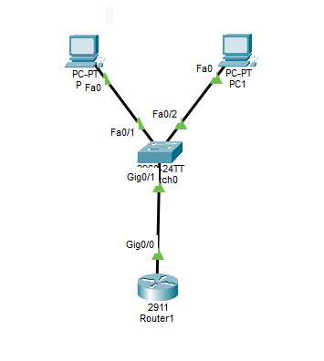
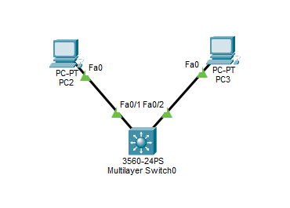
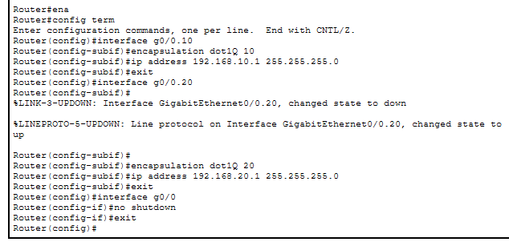
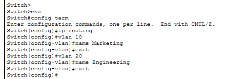
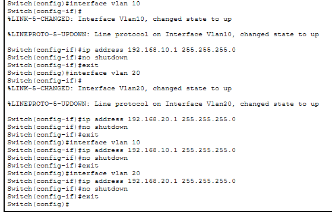
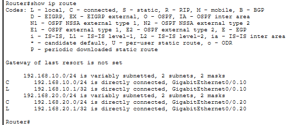
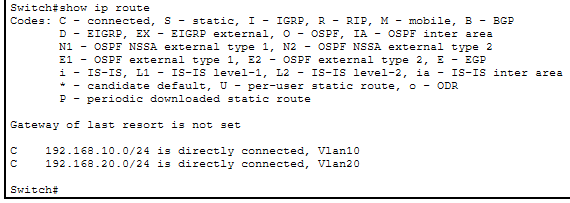
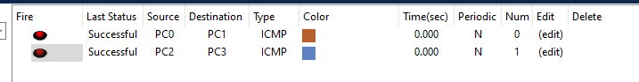
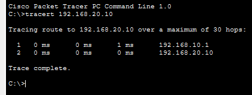

# Manual - Actividad 5

**Universidad San Carlos de Guatemala**  
**Facultad de Ingeniería**  
**Escuela de Ciencias y Sistemas**  
**Curso:** Redes de Computadoras 1  
**Semestre:** Segundo Semestre 2026  
**Estudiante:** Manuel Alejandro López Canel 
**Carnet:** 202302035  

---

## 1. Topología 

#### 1.1 Escenario 1: Router-on-a-Stick (ROAS)

#### 1.2 Escenario 2: Switch de Capa 3 (SVI)

## 2. Captura de la configuración de subinterfaces en el Router (ROAS)

## 3. Captura de la configuración de las interfaces Vlan y el comando ip routing en el Switch L3.

## 4. Captura de la tabla de enrutamiento en ambos dispositivos (show ip route).

## 5. Captura de un ping exitoso entre VLAN 10 y VLAN 20.

## 6. ¿Cuál de los dos métodos considera más eficiente para una red empresarial de alto tráfico y por qué?

El método mediante Switch de Capa 3 (SVI) es el más eficiente para una red empresarial de alto tráfico por dos razones principales:

- Procesamiento por hardware (ASIC): El enrutamiento se realiza a través de circuitos integrados especializados, lo que permite el reenvío de paquetes a la velocidad del cable con una latencia significativamente menor en comparación con el procesamiento basado en CPU de un router tradicional.

- Eliminación del cuello de botella físico: El método Router-on-a-Stick requiere que todo el tráfico inter-VLAN comparta un único enlace troncal para subir y bajar del router, limitando el ancho de banda.