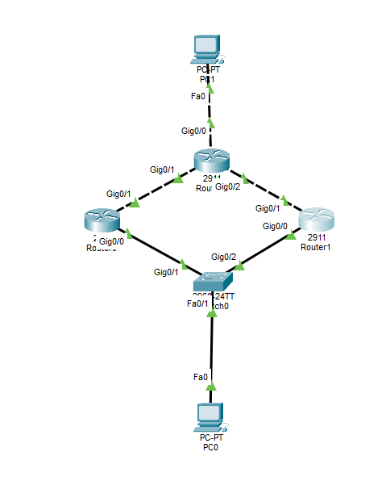
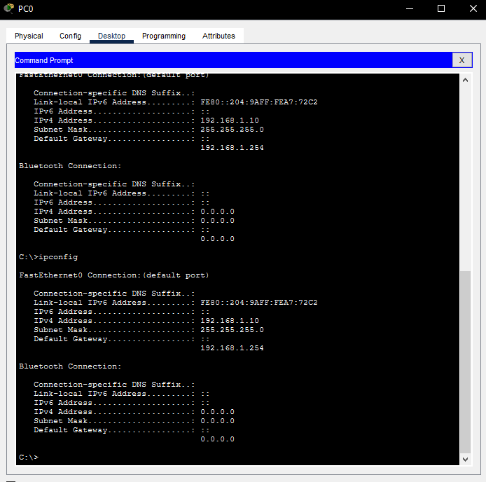
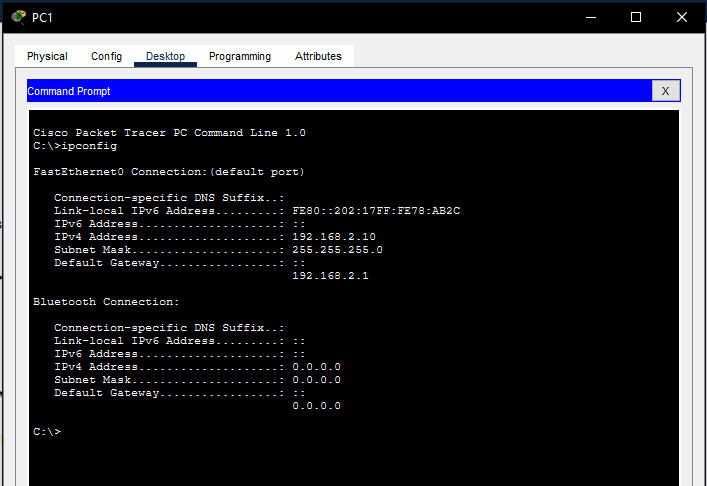
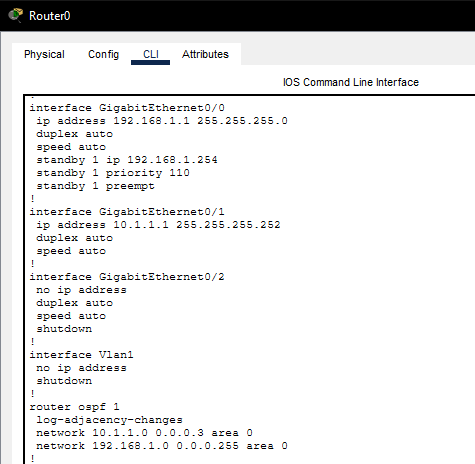
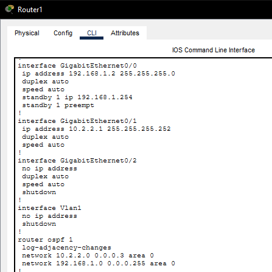
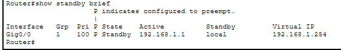
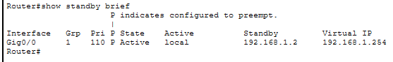
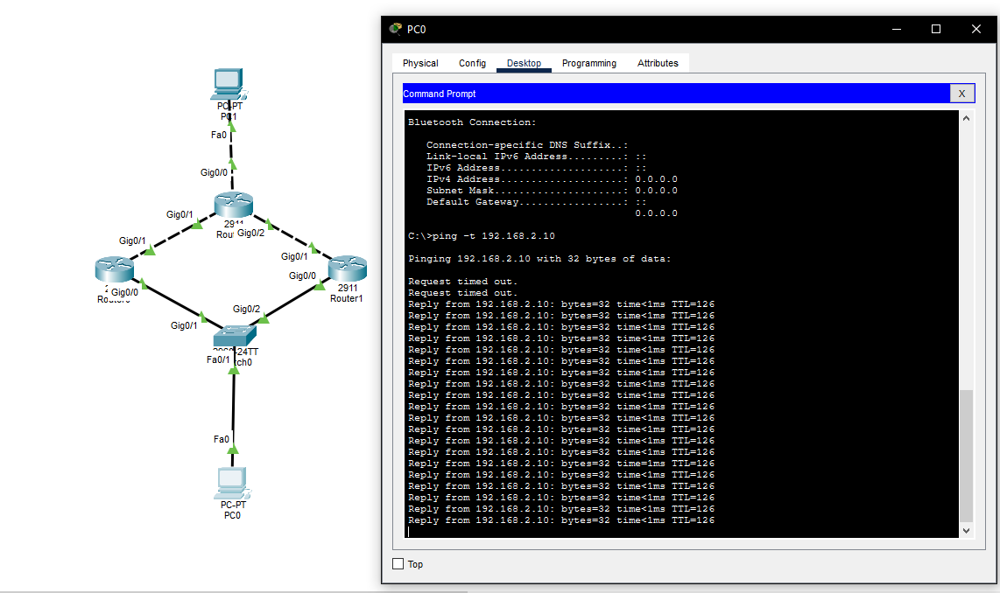
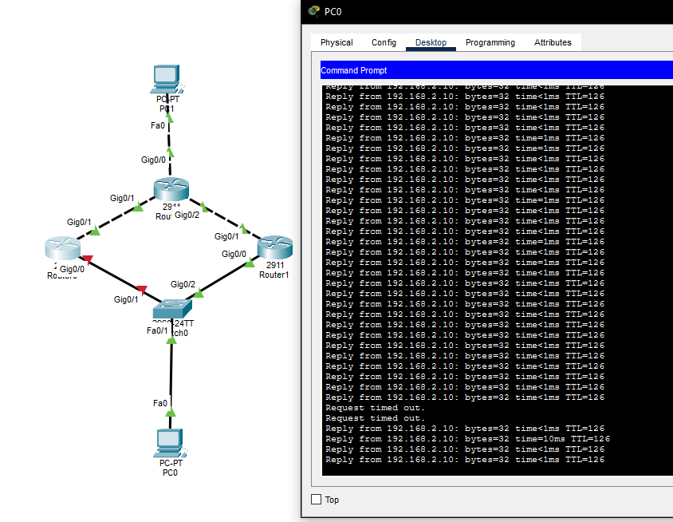
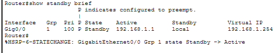

# Actividad Práctica 6 - HSRP

**Universidad San Carlos de Guatemala**  
**Facultad de Ingeniería**  
**Escuela de Ciencias y Sistemas**  
**Curso:** Redes de Computadoras 1  
**Semestre:** Segundo Semestre 2026  
**Estudiante:** Manuel Alejandro López Canel  
**Carnet:** 202302035  

---

## 1. Topología y Configuraciones

### 1.1 Captura de la topología completa

### 1.2 Captura de la configuración IP de la PC inferior

### 1.3 Captura de la configuración IP de la PC superior

### 1.4 Captura de la configuración HSRP del router activo

### 1.5 Captura de la configuración HSRP del router standby

### 1.6 Captura del comando `show standby brief`

## 2. Pruebas de Redundancia y Falla

### 2.1 Captura del ping continuo desde la PC inferior hacia la PC superior

### 2.2 Captura de la falla simulada del router activo

### 2.3 Captura donde se observe que el router standby asumió el rol activo

## 3. Explicación Técnica

**1. ¿Qué IP virtual se utilizó como gateway?**
- *Respuesta:* 192.168.1.254 

**2. ¿Qué router inició como activo?**
- *Respuesta:* El Router Inferior 1 (R0), debido a que se le asignó manualmente una prioridad de 110, superando el valor por defecto.

**3. ¿Qué router inició como standby?**
- *Respuesta:* El Router Inferior 2 (R1), ya que mantuvo la prioridad por defecto de HSRP (100).

**4. ¿Qué ocurrió cuando falló el router activo?**
- *Respuesta:* El protocolo HSRP detectó la caída al dejar de recibir los paquetes hello. Inmediatamente, el router en estado standby (R1) asumió el rol de router activo y comenzó a reenviar el tráfico dirigido a la IP virtual.

**5. ¿Cuánto afectó la falla al ping continuo?**
- *Respuesta:* Se produjo una interrupción momentánea y pérdida de algunos paquetes (mensajes de Request timed out). La conexión se restableció en pocos segundos una vez finalizada la convergencia de HSRP y el protocolo de enrutamiento.

**6. ¿Qué función cumple `preempt` en la práctica?**
- *Respuesta:* Obliga a HSRP a reevaluar las prioridades en la red en tiempo real. Esto permite que el Router Inferior 1 recupere automáticamente el estado de "activo" al momento de encenderse y volver a la red, dado que posee una prioridad mayor (110) frente al router de respaldo (100).
