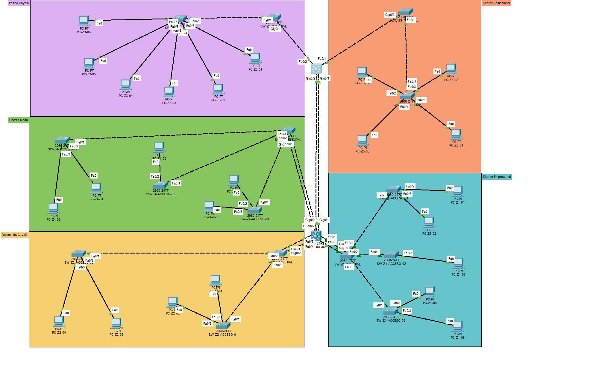
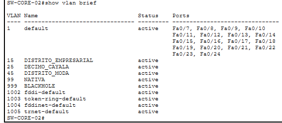
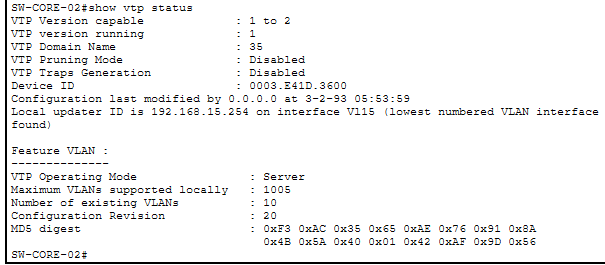
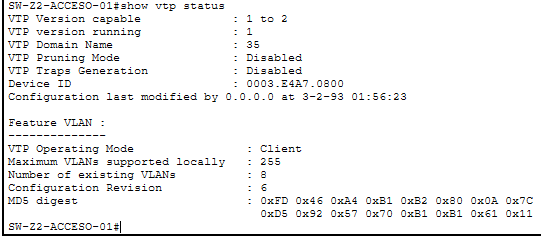
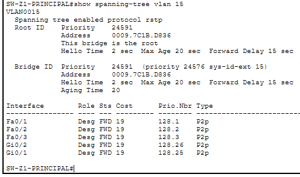
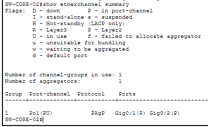
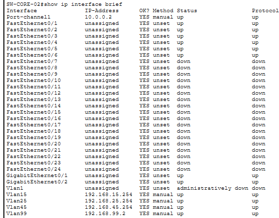
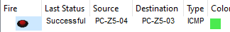
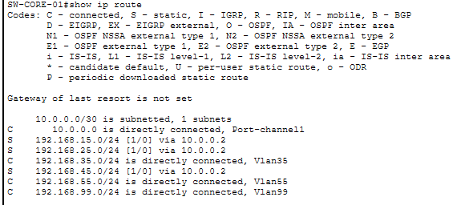
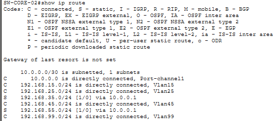

<div align="center">

## UNIVERSIDAD DE SAN CARLOS DE GUATEMALA
## FACULTAD DE INGENIERÍA
## ESCUELA DE INGENIERÍA EN CIENCIAS Y SISTEMAS
### REDES DE COMPUTADORAS 1 — SEGUNDO SEMESTRE 2026

<br>

# DOCUMENTACIÓN TÉCNICA Y MEMORIA DE DESARROLLO
## PROYECTO PRÁCTICO: RED DE LA CIUDAD COMERCIAL CAYALÁ

<br>

**Estudiante:** Manuel Alejandro López Canel  
**Carnet:** 202302035  
**Catedrático / Auxiliar:** César Fernando Sazo Quisquinay  
**Fecha de Entrega:** 10 de octubre de 2026  
**Lugar:** Ciudad de Guatemala, Guatemala  

---

</div>

<div align="justify">

# 1. MANUAL TÉCNICO DE LA INFRAESTRUCTURA DE RED

## 1.1 Justificación Técnica del Diseño de Topología

### 1.1.1 Modelo Híbrido: Núcleo Colapsado / Malla L3 y Estrella Extendida
Para modernizar e interconectar la infraestructura de telecomunicaciones de la Ciudad Comercial Cayalá, se seleccionó una arquitectura de red **híbrida jerárquica**. Este diseño combina dos modelos estandarizados de la industria:
1. **Núcleo Colapsado / Malla Parcial de Capa 3:** Implementado en el backbone central mediante dos switches multicapa Cisco Catalyst 3560 (`Core-1` y `Core-2`), interconectados a través de un enlace lógico de agregación EtherChannel de Capa 3. En este estrato se colapsan las funciones de la capa de distribución y de núcleo, centralizando las interfaces virtuales conmutadas (SVIs) y el enrutamiento inter-zonal.
2. **Estrella Extendida por Zonas (Capa 2):** Implementada hacia las áreas periféricas mediante 15 switches Cisco Catalyst 2960. Cada una de las 5 zonas comerciales, residenciales y corporativas cuenta con un switch principal de zona (nodo de distribución local) que se conecta directamente a uno de los Cores, ramificándose hacia switches de acceso dedicados a los dispositivos finales.


Esta estructura híbrida previene los cuellos de botella característicos de una topología en bus o anillo simple, suprime puntos únicos de falla críticos mediante enlaces redundantes en las zonas de mayor demanda, y minimiza la propagación indebida de tramas de difusión (*broadcast storms*).

### 1.1.2 Bisección del Núcleo (Core 1 vs Core 2) y Distribución de Cargas
Una de las restricciones cardinales en el diseño de redes corporativas de gran escala es evitar la sobrecarga de un único conmutador de distribución. En el complejo Cayalá coexisten actividades con patrones de tráfico sumamente dispares: transacciones corporativas, comercio masivo de alta concurrencia, entretenimiento y navegación residencial. 

Por esta razón, la red se segmentó de forma deliberada entre dos conmutadores multicapa:
* **Core-2 (Núcleo de Alta Densidad y Flujo Comercial/Financiero):** Conecta las **Zonas 1, 2 y 4**. Este conmutador soporta el mayor caudal de paquetes por segundo (pps) debido a la presencia de terminales de punto de venta (POS), servicios bancarios, ofimática empresarial y cámaras de vigilancia comercial. Para garantizar que la infraestructura física no se sature, cada uno de estos enlaces troncales implementa agregación de enlaces **EtherChannel PAgP**, duplicando el ancho de banda efectivo y proveyendo conmutación por fallo (*failover*) sin pérdida de enlace.
* **Core-1 (Núcleo de Carga Moderada y Servicios Comunitarios):** Conecta las **Zonas 3 y 5**. Atiende áreas con baja y moderada tasa de tráfico recurrente (Paseo peatonal y Sector Residencial). Al contar con volúmenes de hosts sustancialmente menores (12 y 7 hosts respectivamente), estas zonas se conectan mediante enlaces troncales dedicados de alta velocidad sin requerir agregación física múltiple, optimizando el aprovechamiento de puertos físicos en el chasis sin comprometer la calidad del servicio.

Esta división física y lógica proporciona **aislamiento de fallas**: cualquier degradación o incidente técnico severo originado en el tráfico masivo de las tiendas o comercios queda confinado al segmento de `Core-2`, manteniendo operativos los servicios residenciales y administrativos de `Core-1`.

### 1.1.3 Análisis Operativo y Selección de Zonas Reales de Ciudad Cayalá
De acuerdo con la investigación de las áreas operativas reales del complejo urbano Ciudad Cayalá, se identificaron y modelaron los siguientes cinco sectores funcionales:

| Zona | Nombre Real en Cayalá | Rol Operativo y Perfil de Usuarios | Volumen de Tráfico Estimado | Nivel de Criticidad | Impacto Operativo por Pérdida de Enlace | Conexión al Núcleo | Mecanismo de Enlace |
| :---: | :--- | :--- | :--- | :---: | :--- | :---: | :---: |
| **Zona 1** | **Distrito Empresarial** | Oficinas corporativas, consultorías, firmas jurídicas y servicios financieros. Usuarios con alta demanda de conectividad a servidores, videollamadas corporativas y transferencias de datos seguras. | **Alto**<br>(60 Hosts requeridos) | **Alta** | **Catastrófico:** Interrupción de operaciones bursátiles, cobros electrónicos, soporte empresarial y SLA corporativos. | `Core-2` | EtherChannel L2 (PAgP) con 2 enlaces físicos |
| **Zona 2** | **Décimo de Cayalá** | Torre corporativa y centro de oficinas ejecutivas, clínicas médicas especializadas y sedes diplomáticas. Requerimiento de alta confidencialidad y continuidad de negocio. | **Medio - Alto**<br>(28 Hosts requeridos) | **Alta** | **Severo:** Paralización de citas médicas, sistemas hospitalarios ambulatorios y canales ejecutivos. | `Core-2` | EtherChannel L2 (PAgP) con 2 enlaces físicos |
| **Zona 3** | **Paseo Cayalá** | Área peatonal comercial principal, plazas abiertas, quioscos turísticos y cafeterías al aire libre. Usuarios flotantes y terminales móviles. | **Medio**<br>(12 Hosts requeridos) | **Media** | **Moderado:** Degeneración temporal en la experiencia de visitantes y conectividad en quioscos auxiliares. | `Core-1` | Enlace Troncal Simple FastEthernet / Gigabit |
| **Zona 4** | **Distrito Moda** | Boutiques exclusivas, tiendas de retail departamental, pasarelas y restaurantes de alta gama. Terminales de cobro (POS), control de inventarios e infraestructura Wi-Fi comercial. | **Alto**<br>(50 Hosts requeridos) | **Media - Alta** | **Grave:** Pérdida inmediata de ventas al detalle, fallo en procesamiento de tarjetas de crédito e inventarios en línea. | `Core-2` | EtherChannel L2 (PAgP) con 2 enlaces físicos |
| **Zona 5** | **Sector Residencial** | Condominios cerrados, apartamentos y áreas habitacionales privadas. Tráfico de domótica, entretenimiento y navegación web domiciliaria. | **Bajo**<br>(7 Hosts requeridos) | **Baja** | **Leve:** Pérdida de confort y entretenimiento doméstico, sin impacto comercial ni corporativo en el complejo. | `Core-1` | Enlace Troncal Simple FastEthernet / Gigabit |

### 1.1.4 Inventario y Distribución de Dispositivos de Red
La infraestructura implementada en Cisco Packet Tracer consta de un total de **17 dispositivos conmutadores**, clasificados funcionalmente de la siguiente manera:

1. **Capa de Núcleo y Distribución Central (2 Conmutadores Multicapa):**
   * `Core-1` (Cisco Catalyst 3560-24PS): Administrador de Capa 3 para Zonas 3 y 5.
   * `Core-2` (Cisco Catalyst 3560-24PS): Administrador de Capa 3 para Zonas 1, 2 y 4.
2. **Capa de Distribución Zonal y Acceso (15 Conmutadores de Capa 2 Cisco Catalyst 2960-24TT):**
   * **Zona 1 (Empresarial):** 3 Switches (1 Switch Principal/Distribución `SW-Z1-P` + 2 Switches de Acceso `SW-Z1-A1`, `SW-Z1-A2`).
   * **Zona 2 (Décimo de Cayalá):** 3 Switches (1 Switch Principal/Distribución `SW-Z2-P` + 2 Switches de Acceso `SW-Z2-A1`, `SW-Z2-A2`).
   * **Zona 3 (Paseo Cayalá):** 3 Switches (1 Switch Principal/Distribución `SW-Z3-P` + 2 Switches de Acceso `SW-Z3-A1`, `SW-Z3-A2`).
   * **Zona 4 (Distrito Moda):** 3 Switches (1 Switch Principal/Distribución `SW-Z4-P` + 2 Switches de Acceso `SW-Z4-A1`, `SW-Z4-A2`).
   * **Zona 5 (Sector Residencial):** 3 Switches (1 Switch Principal/Distribución `SW-Z5-P` + 2 Switches de Acceso `SW-Z5-A1`, `SW-Z5-A2`).

### 1.1.5 Medios de Transmisión y Estándar de Cableado TIA/EIA-568B
En cumplimiento estricto con los requerimientos técnicos y las normativas internacionales de cableado estructurado:
* **Estándar de Conectorización:** Se adopta la norma **ANSI/TIA/EIA-568B**, estableciendo la secuencia pin a pin en conectores RJ-45:
  1. Blanco-Naranja
  2. Naranja
  3. Blanco-Verde
  4. Azul
  5. Blanco-Azul
  6. Verde
  7. Blanco-Marrón
  8. Marrón
* **Tipología de Cables y Medios de Enlace:**
  * **Cable Directo (*Straight-Through*):** Empleado en enlaces entre dispositivos de distinta capa jerárquica u operativa (Switch a Host/PC).
  * **Cable Cruzado (*Crossover*):** Empleado para la interconexión conmutador a conmutador (Switch a Switch y Core a Switch).
  * **Enlaces GigabitEthernet:** Reservados primordialmente para los enlaces troncales de mayor demanda y la interconexión entre Cores.
  * **Enlaces FastEthernet:** Asignados a la conectividad de los puertos de acceso hacia estaciones terminales y distribución interna.

### 1.1.6 Diagrama General de la Topología en Cisco Packet Tracer



---

## 1.2 Esquema de Segmentación y Direccionamiento IP (VLANs)

### 1.2.1 Tabla Maestra de Asignación de VLANs y Subredes
De acuerdo con las directrices académicas del curso, los identificadores de VLAN deben cumplir con la estructura `1X`, `2X`, `3X`, `4X`, `5X`, donde **X** corresponde al último dígito del carnet estudiantil. Dado que el carnet asignado es **202302035**, la variable toma el valor **X = 5**.

El esquema de direccionamiento IPv4 asignado por la administración de Cayalá corresponde a subredes de clase C estándar `/24` (`192.168.X.0/24`), reservando uniformemente la última dirección IP utilizable (`.254`) como la Puerta de Enlace Predeterminada (*Default Gateway*) configurada en la SVI de cada Core.

| Zona | Nombre de la Zona | VLAN ID | Hosts Requeridos | Hosts Útiles Disponibles (/24) | Dirección de Red IPv4 | Máscara de Subred | Puerta de Enlace (*Gateway*) | Dirección de *Broadcast* | Switch Core Responsable |
| :---: | :--- | :---: | :---: | :---: | :---: | :---: | :---: | :---: | :---: |
| **Zona 1** | Distrito Empresarial | **15** | 60 | 254 | `192.168.15.0` | `255.255.255.0` | `192.168.15.254` | `192.168.15.255` | `Core-2` |
| **Zona 2** | Décimo de Cayalá | **25** | 28 | 254 | `192.168.25.0` | `255.255.255.0` | `192.168.25.254` | `192.168.25.255` | `Core-2` |
| **Zona 3** | Paseo Cayalá | **35** | 12 | 254 | `192.168.35.0` | `255.255.255.0` | `192.168.35.254` | `192.168.35.255` | `Core-1` |
| **Zona 4** | Distrito Moda | **45** | 50 | 254 | `192.168.45.0` | `255.255.255.0` | `192.168.45.254` | `192.168.45.255` | `Core-2` |
| **Zona 5** | Sector Residencial | **55** | 7 | 254 | `192.168.55.0` | `255.255.255.0` | `192.168.55.254` | `192.168.55.255` | `Core-1` |
| **Enlace Inter-Core** | Backbone L3 PAgP | **N/A (L3)** | 2 | 2 | `10.0.0.0` | `255.255.255.252` (/30) | N/A (Punto a Punto) | `10.0.0.3` | `Core-1` y `Core-2` |



### 1.2.2 VLANs Administrativas y de Seguridad (VLAN 99 y VLAN 999)
Para blindar la red contra vectores de ataque de Capa 2 y preservar la estabilidad de los conmutadores, se establecieron dos VLANs complementarias obligatorias:

1. **VLAN 99 (VLAN Nativa y de Gestión Administrativa):**
   * **Propósito:** El estándar IEEE 802.1Q transmite el tráfico sin etiquetar (*untagged*) a través de la VLAN Nativa por defecto (VLAN 1). Dejar la VLAN 1 activa y como nativa expone la infraestructura a vulnerabilidades severas como el salto de VLAN (*VLAN Hopping / Double Tagging*).
   * **Implementación:** Se reasignó la VLAN Nativa a la **VLAN 99** en todos los enlaces troncales de la topología. Cualquier trama no etiquetada o tráfico de protocolos de control (CDP, PAgP, STP) es aislado en este segmento.
2. **VLAN 999 (VLAN Blackhole / Agujero Negro):**
   * **Propósito:** Evitar intrusiones por conexión directa a puertos físicos no utilizados en los paneles de parcheo y switches.
   * **Implementación:** Todos los puertos FastEthernet y GigabitEthernet que no participan activamente en enlaces troncales ni tienen terminales conectadas fueron asignados de manera forzada a la **VLAN 999** en modo acceso, desactivándolos administrativamente mediante la instrucción `shutdown`. De esta forma, si un usuario no autorizado conecta un dispositivo físico a una toma libre, no recibirá concesión de direccionamiento ni acceso a los dominios de difusión corporativos.

### 1.2.3 Política de Enlaces Troncales y Poda de VLANs
Para evitar el desbordamiento de tráfico innecesario en la red (*flooding*), se prohibió explícitamente el uso de la directiva por defecto `switchport trunk allowed vlan all`.

Cada enlace troncal de la topología fue configurado bajo un principio de **privilegio mínimo de tráfico**, permitiendo de manera estricta únicamente la VLAN nativa, la VLAN de gestión y la VLAN específica que pertenece a la zona atendida:
* **Troncales hacia Zona 1:** `switchport trunk allowed vlan 15,99`
* **Troncales hacia Zona 2:** `switchport trunk allowed vlan 25,99`
* **Troncales hacia Zona 3:** `switchport trunk allowed vlan 35,99`
* **Troncales hacia Zona 4:** `switchport trunk allowed vlan 45,99`
* **Troncales hacia Zona 5:** `switchport trunk allowed vlan 55,99`

---

## 1.3 Análisis de Dominios de Colisión y Dominios de Difusión

### 1.3.1 Fundamento Teórico y Delimitación en el Modelo OSI
La comprensión y correcta delimitación de los dominios de red constituye uno de los pilares del diseño según los lineamientos de la certificación Cisco CCNA (Wendell Odom, 2019):
* **Dominio de Colisión (Capa 1/Capa 2):** Es el segmento de red donde es posible que dos o más dispositivos transmitan tramas de datos simultáneamente sobre el mismo medio compartido, provocando interferencia física destructiva y requiriendo retransmisión mediante algoritmos como CSMA/CD. En la tecnología Ethernet moderna, los conmutadores (*switches*) operan bajo **microsegmentación**: cada puerto de switch individual representa un límite físico que confina y aísla un dominio de colisión único. Además, al operar en modo **Full-Duplex**, los canales de transmisión (Tx) y recepción (Rx) se encuentran separados físicamente, eliminando por completo la posibilidad de colisiones.
* **Dominio de Difusión / *Broadcast Domain* (Capa 2/Capa 3):** Es el área lógica de la red en la cual una trama de difusión (*broadcast*, dirección MAC destino `FFFF.FFFF.FFFF`) enviada por cualquier estación es recibida y procesada por todos los demás dispositivos del segmento. Los conmutadores de Capa 2 propagan las difusiones por todos sus puertos activos pertenecientes a la misma VLAN. Por consiguiente, **los únicos dispositivos capaces de delimitar y fragmentar dominios de difusión son los enrutadores y los switches multicapa mediante interfaces de Capa 3 y la segmentación en VLANs**.

### 1.3.2 Cuantificación Detallada de Dominios de Colisión
En la infraestructura de Ciudad Cayalá, no se utilizó ningún concentrador pasivo (*hub*); todos los nodos están conectados a puertos dedicados en conmutadores Cisco Catalyst (modelos 2960 y 3560). Por consiguiente, **el número total de dominios de colisión es exactamente igual al número de puertos físicos activos y enlazados en la topología**.

```
+----------------------------------------------------------------------------------------------------+
|                                 CENSO DE DOMINIOS DE COLISIÓN                                      |
+--------------------------------------------------------------------+-------------------------------+
| Segmento de Conexión Física                                        | Dominios de Colisión Activos  |
+--------------------------------------------------------------------+-------------------------------+
| 1. Enlace Punto a Punto Inter-Core (L3 Port-Channel 1: 2 enlaces)   | 2 dominios (G0/1-G0/1, G0/2)  |
| 2. Enlaces Troncales Core-2 hacia Zona 1 (L2 PAgP: 2 enlaces)      | 2 dominios físicos            |
| 3. Enlaces Troncales Core-2 hacia Zona 2 (L2 PAgP: 2 enlaces)      | 2 dominios físicos            |
| 4. Enlaces Troncales Core-2 hacia Zona 4 (L2 PAgP: 2 enlaces)      | 2 dominios físicos            |
| 5. Enlace Troncal Core-1 hacia Zona 3 (1 enlace simple)            | 1 dominio físico              |
| 6. Enlace Troncal Core-1 hacia Zona 5 (1 enlace simple)            | 1 dominio físico              |
| 7. Enlaces Internos Switch Principal a Switches Acceso (5 zonas):  |                               |
|    - Zona 1: SW-Z1-P hacia SW-Z1-A1 y SW-Z1-A2 (2 enlaces)         | 2 dominios físicos            |
|    - Zona 2: SW-Z2-P hacia SW-Z2-A1 y SW-Z2-A2 (2 enlaces)         | 2 dominios físicos            |
|    - Zona 3: SW-Z3-P hacia SW-Z3-A1 y SW-Z3-A2 (2 enlaces)         | 2 dominios físicos            |
|    - Zona 4: SW-Z4-P hacia SW-Z4-A1 y SW-Z4-A2 (2 enlaces)         | 2 dominios físicos            |
|    - Zona 5: SW-Z5-P hacia SW-Z5-A1 y SW-Z5-A2 (2 enlaces)         | 2 dominios físicos            |
| 8. Enlaces de Acceso hacia Estaciones Terminales (Hosts simulados):|                               |
|    - Zona 1 (Distrito Empresarial): Terminales activas             | 4 dominios de acceso          |
|    - Zona 2 (Décimo de Cayalá): Terminales activas                 | 3 dominios de acceso          |
|    - Zona 3 (Paseo Cayalá): Terminales activas                     | 2 dominios de acceso          |
|    - Zona 4 (Distrito Moda): Terminales activas                    | 3 dominios de acceso          |
|    - Zona 5 (Sector Residencial): Terminales activas               | 2 dominios de acceso          |
+--------------------------------------------------------------------+-------------------------------+
| TOTAL DE DOMINIOS DE COLISIÓN ACTIVOS EN EL ENTORNO OPERATIVO:     | 34 Dominios de Colisión       |
+--------------------------------------------------------------------+-------------------------------+
```

### 1.3.3 Cuantificación y Justificación de los Dominios de Difusión (Broadcast)
En esta topología se encuentran delimitados un total de **8 Dominios de Difusión**:

1. **Dominio 1 (VLAN 15 - Distrito Empresarial):** Confinado al Core-2 y a los conmutadores de la Zona 1.
2. **Dominio 2 (VLAN 25 - Décimo de Cayalá):** Confinado al Core-2 y a los conmutadores de la Zona 2.
3. **Dominio 3 (VLAN 35 - Paseo Cayalá):** Confinado al Core-1 y a los conmutadores de la Zona 3.
4. **Dominio 4 (VLAN 45 - Distrito Moda):** Confinado al Core-2 y a los conmutadores de la Zona 4.
5. **Dominio 5 (VLAN 55 - Sector Residencial):** Confinado al Core-1 y a los conmutadores de la Zona 5.
6. **Dominio 6 (VLAN 99 - Nativa / Gestión):** Aislado para tramas de administración y control entre conmutadores.
7. **Dominio 7 (VLAN 999 - Blackhole):** Segmento de contención cerrado para interfaces en desuso.
8. **Dominio 8 (Enlace L3 Inter-Core 10.0.0.0/30):** Enlace punto a punto de Capa 3 que interconecta `Core-1` y `Core-2`. Dado que este enlace no transporta tramas de Capa 2 sin enrutar, delimita estrictamente la propagación de difusiones entre ambos núcleos.

---

## 1.4 Protocolos de Capa 2 y Alta Disponibilidad

### 1.4.1 VLAN Trunking Protocol (VTP)
Para mantener la consistencia en la creación, nombrado y mantenimiento de la base de datos de VLANs a través de la topología sin incurrir en divergencias humanas, se configuró el protocolo propietario de Cisco **VTP**:
* **Versión:** VTP Versión 2.
* **Dominio VTP:** `35` (correspondiente a los dos últimos dígitos del carnet estudiantil `202302035`).
* **Contraseña VTP:** `cayala`.
* **Jerarquía Operativa:**
  * **Modo Servidor (*VTP Server*):** Configurado en los dos switches multicapa (`Core-1`, `Core-2`) y en el switch principal de cada una de las 5 zonas.
  * **Modo Cliente (*VTP Client*):** Configurado en todos los switches de acceso secundarios (`SW-Zx-ACCESO-01` y `SW-Zx-ACCESO-02`).




### 1.4.2 Spanning Tree Protocol: Rapid PVST+ (IEEE 802.1w)
Para prevenir bucles de capa 2 y garantizar una rápida convergencia, se habilitó **Rapid PVST+** en toda la red.

| VLAN ID | Nombre de la VLAN | Switch Designado como Root Bridge | Prioridad STP Configurada | Comando CLI Aplicado | Justificación de la Selección |
| :---: | :--- | :--- | :---: | :--- | :--- |
| **VLAN 15** | Distrito Empresarial | Switch Principal Zona 1 (`SW-Z1-P`) | **4096** | `spanning-tree vlan 15 root primary` | Centraliza el árbol Spanning Tree en el nodo de distribución de la zona corporativa. |
| **VLAN 25** | Décimo de Cayalá | Switch Principal Zona 2 (`SW-Z2-P`) | **4096** | `spanning-tree vlan 25 root primary` | Optimiza el tráfico local entre clínicas y oficinas ejecutivas. |
| **VLAN 35** | Paseo Cayalá | Switch Principal Zona 3 (`SW-Z3-P`) | **4096** | `spanning-tree vlan 35 root primary` | Evita que el enlace hacia Core-1 soporte convergencias innecesarias. |
| **VLAN 45** | Distrito Moda | Switch Principal Zona 4 (`SW-Z4-P`) | **4096** | `spanning-tree vlan 45 root primary` | Dirige el tráfico de las tiendas departamentales hacia su nodo concentrador. |
| **VLAN 55** | Sector Residencial | Switch Principal Zona 5 (`SW-Z5-P`) | **4096** | `spanning-tree vlan 55 root primary` | Aísla las transiciones de puerto residenciales del resto del complejo. |
| **VLAN 99** | Gestión / Nativa | `Core-1` (Primario) / `Core-2` (Secundario) | **4096** / **8192** | `spanning-tree vlan 99 priority 4096` | Garantiza una raíz estable en el backbone central para el tráfico de control. |



### 1.4.3 Agregación de Enlaces: EtherChannel bajo Protocolo PAgP
En conformidad con las especificaciones del proyecto y la regla de carnet (último dígito **5**, impar), se empleó el protocolo de agregación propietario de Cisco **PAgP** (*Port Aggregation Protocol*):
* **Modos de Negociación:** Se configuró el modo `desirable` en el extremo principal y modo `auto` (o `desirable`) en el conector remoto.
* **Implementación Capa 2 en Zonas Críticas (Zonas 1, 2 y 4):**
  * Se agruparon pares de interfaces físicas FastEthernet/GigabitEthernet en enlaces virtuales `Port-channel 1`.
  * **Justificación:** Estas tres zonas representan la mayor demanda transaccional y comercial de Cayalá (60, 28 y 50 hosts respectivamente). Al agrupar dos enlaces, se incrementa el ancho de banda efectivo y se provee tolerancia a fallos inmediata ante cortes físicos.



---

## 1.5 Enrutamiento Inter-VLAN y Capa 3

### 1.5.1 Switched Virtual Interfaces (SVIs) en Switches Multicapa
El enrutamiento entre las distintas zonas de Ciudad Cayalá se realiza dentro de los switches multicapa Cisco Catalyst 3560 mediante interfaces virtuales conmutadas (SVIs):
* **En `Core-1`:**
  * SVI VLAN 35 (Paseo Cayalá): `192.168.35.254 /24`
  * SVI VLAN 55 (Residencial): `192.168.55.254 /24`
* **En `Core-2`:**
  * SVI VLAN 15 (Empresarial): `192.168.15.254 /24`
  * SVI VLAN 25 (Décimo): `192.168.25.254 /24`
  * SVI VLAN 45 (Moda): `192.168.45.254 /24`

### 1.5.2 Enlace Punto a Punto Inter-Core (L3 EtherChannel)
Se configuró un enlace punto a punto de Capa 3 en el EtherChannel que une a `Core-1` y `Core-2`:
* **Subred de Tránsito:** `10.0.0.0/30` (`255.255.255.252`).
* **IP en `Core-1` (Port-channel 1):** `10.0.0.1`
* **IP en `Core-2` (Port-channel 1):** `10.0.0.2`

### 1.5.3 Tabla de Enrutamiento Estático Inter-Core
Para permitir el alcance bidireccional entre las subredes de ambos núcleos, se definieron las siguientes rutas estáticas IPv4:

```
+----------------------------------------------------------------------------------------------------+
|                             RUTAS ESTÁTICAS CONFIGURADAS EN CORE-1                                 |
+----------------------------------------------------------------------------------------------------+
! Hacia Zona 1 (Distrito Empresarial):
Core-1(config)# ip route 192.168.15.0 255.255.255.0 10.0.0.2
! Hacia Zona 2 (Décimo de Cayalá):
Core-1(config)# ip route 192.168.25.0 255.255.255.0 10.0.0.2
! Hacia Zona 4 (Distrito Moda):
Core-1(config)# ip route 192.168.45.0 255.255.255.0 10.0.0.2
+----------------------------------------------------------------------------------------------------+

+----------------------------------------------------------------------------------------------------+
|                             RUTAS ESTÁTICAS CONFIGURADAS EN CORE-2                                 |
+----------------------------------------------------------------------------------------------------+
! Hacia Zona 3 (Paseo Cayalá):
Core-2(config)# ip route 192.168.35.0 255.255.255.0 10.0.0.1
! Hacia Zona 5 (Sector Residencial):
Core-2(config)# ip route 192.168.55.0 255.255.255.0 10.0.0.1
+----------------------------------------------------------------------------------------------------+
```

---

# 2. INFORME DE DESARROLLO Y MEMORIA TÉCNICA

## 2.1 Metodología de Implementación Paso a Paso

### 2.1.1 Fase 1: Despliegue Físico y Topología Base
1. Se colocaron en el espacio de trabajo de Cisco Packet Tracer dos switches multicapa Cisco Catalyst 3560 (`Core-1` y `Core-2`) y quince switches Cisco Catalyst 2960 divididos equitativamente en 5 grupos zonales (tres por zona).
2. Se interconectaron físicamente los puertos GigabitEthernet `G0/1` y `G0/2` de ambos Cores mediante cables cruzados.
3. Se tendieron los enlaces hacia los conmutadores principales de cada zona (`Core-2` a Zonas 1, 2, 4 con 2 enlaces físicos PAgP; `Core-1` a Zonas 3 y 5 con 1 enlace físico simple).
4. Se conectaron los conmutadores de acceso a sus switches principales y las estaciones de trabajo terminales.

### 2.1.2 Fase 2: Creación de VLANs y Configuración VTP
1. En cada switch principal zonal y conmutadores Core, se declaró el dominio y la contraseña de VTP:
   ```cisco
   Switch(config)# vtp domain 35
   Switch(config)# vtp password cayala2026
   Switch(config)# vtp mode server
   ```
2. Se definieron las identidades de las VLANs zonales, nativa (99) y blackhole (999).
3. En los switches de acceso secundarios, se aplicó `vtp mode client` para recibir la base de datos de VLANs de su switch principal.

### 2.1.3 Fase 3: Troncalización y Agregación EtherChannel (PAgP)
1. **Configuración de Enlaces Troncales Capa 2 con PAgP (Zonas 1, 2 y 4):**
   ```cisco
   interface range FastEthernet 0/1 - 2
    channel-protocol pagp
    channel-group 1 mode desirable
   exit

   interface port-channel 1
    switchport trunk encapsulation dot1q
    switchport mode trunk
    switchport trunk native vlan 99
    switchport trunk allowed vlan 15,99  ! (Adaptado a cada zona)
   exit
   ```
2. **Configuración de Troncales Simples (Zonas 3 y 5):**
   ```cisco
   interface GigabitEthernet 0/1
    switchport trunk encapsulation dot1q
    switchport mode trunk
    switchport trunk native vlan 99
    switchport trunk allowed vlan 35,99  ! (En Zona 3)
   exit
   ```
3. **Configuración del EtherChannel Capa 3 Inter-Core:**
   En los enlaces `G0/1` y `G0/2` de ambos Cores:
   ```cisco
   ! En Core-1:
   interface range GigabitEthernet 0/1 - 2
    no switchport
    channel-protocol pagp
    channel-group 1 mode desirable
   exit
   interface port-channel 1
    ip address 10.0.0.1 255.255.255.252
   exit

   ! En Core-2:
   interface range GigabitEthernet 0/1 - 2
    no switchport
    channel-protocol pagp
    channel-group 1 mode desirable
   exit
   interface port-channel 1
    ip address 10.0.0.2 255.255.255.252
   exit
   ```

### 2.1.4 Fase 4: Configuración de Rapid PVST+ y Elección de Root Bridges
1. En **todos** los conmutadores se forzó el modo rápido de árbol de expansión:
   ```cisco
   Switch(config)# spanning-tree mode rapid-pvst
   ```
2. En cada switch principal zonal, se estableció la prioridad de raíz para su respectiva VLAN:
   ```cisco
   SW-Z1-P(config)# spanning-tree vlan 15 root primary
   SW-Z2-P(config)# spanning-tree vlan 25 root primary
   SW-Z3-P(config)# spanning-tree vlan 35 root primary
   SW-Z4-P(config)# spanning-tree vlan 45 root primary
   SW-Z5-P(config)# spanning-tree vlan 55 root primary
   ```

### 2.1.5 Fase 5: Habilitación de Capa 3, SVIs y Rutas Estáticas
1. Se activó el motor de conmutación multicapa con `ip routing` en `Core-1` y `Core-2`.
2. Se asignaron las direcciones IP correspondientes a las SVIs de cada zona (`.254/24`).
3. Se insertaron las rutas estáticas apuntando a la IP vecina del `Port-channel 1`.

### 2.1.6 Fase 6: Configuración de End-Devices y Hardening de Puertos
1. Se asignaron direcciones IP estáticas a los hosts con máscara `/24` y default gateway `.254`.
2. Se aseguraron todos los puertos no conectados en los conmutadores asignándolos a la VLAN 999:
   ```cisco
   Switch(config)# interface range FastEthernet 0/10 - 24
   Switch(config-if-range)# switchport mode access
   Switch(config-if-range)# switchport access vlan 999
   Switch(config-if-range)# shutdown
   ```

---

## 2.2 Incidentes Técnicos Enfrentados y Soluciones de Ingeniería

### 2.2.1 Incidente 1: Rechazo de Sintaxis `no switchport` en Port-Channel L3
* **Síntoma / Mensaje de Error:** Al intentar convertir el canal lógico a Capa 3 dentro de la interfaz `interface port-channel 1` mediante el comando `no switchport`, el simulador Cisco Packet Tracer emitió un mensaje de rechazo de sintaxis o error de comando inválido (`% Invalid input detected at '^' marker`).
* **Causa Raíz:** En la implementación del emulador IOS de Cisco Packet Tracer en conmutadores Catalyst 3560, cuando un rango de interfaces físicas ya fue configurado previamente con `no switchport` antes de asociarlo al grupo del canal (`channel-group 1`), el emulador automáticamente genera la interfaz lógica `port-channel 1` heredando el modo enrutado. Si el operador intenta reejecutar `no switchport` dentro de la subinterfaz lógica ya creada, el parser CLI del simulador colisiona al considerar redundante o no aplicable dicha instrucción.
* **Solución de Ingeniería Adoptada:** Omitir la repetición del comando `no switchport` dentro de la interfaz virtual `interface port-channel 1` y proceder directamente a la asignación de la dirección IP de tránsito de Capa 3:
  ```cisco
  Core-1(config)# interface range gigabitEthernet 0/1 - 2
  Core-1(config-if-range)# no switchport
  Core-1(config-if-range)# channel-protocol pagp
  Core-1(config-if-range)# channel-group 1 mode desirable
  Core-1(config-if-range)# exit
  Core-1(config)# interface port-channel 1
  Core-1(config-if)# ip address 10.0.0.1 255.255.255.252
  Core-1(config-if)# no shutdown
  ```



### 2.2.2 Incidente 2: Inconsistencia de VLAN Nativa (`CDP-4-NATIVE_VLAN_MISMATCH`)
* **Síntoma / Mensaje de Error:** Durante el proceso de troncalización manual, al configurar el switch local con la VLAN nativa 99, la consola comenzó a arrojar de manera repetitiva las siguientes alertas del sistema:
  ```
  %CDP-4-NATIVE_VLAN_MISMATCH: Native VLAN mismatch discovered on GigabitEthernet0/1 (99), with Switch FastEthernet0/1 (1).
  %SPANTREE-2-BLOCK_PVID_LOCAL: Blocking GigabitEthernet0/1 on VLAN0099. Inconsistent local vlan.
  ```
  El conmutador bloqueó temporalmente el puerto físico, interrumpiendo el paso de cualquier trama.
* **Causa Raíz:** El protocolo Cisco Discovery Protocol (CDP) monitorea periódicamente la coincidencia de parámetros en ambos extremos del enlace físico. Al configurar `switchport trunk native vlan 99` en el primer conmutador mientras el conmutador remoto aún operaba con el valor predeterminado (VLAN 1), se produjo una discrepancia de PVID (*Port VLAN Identifier*). Spanning Tree (PVST+) activó de inmediato su mecanismo de protección para prevenir bucles entre VLANs dispares, colocando el puerto en estado *Type-Inconsistent (Blocking)*.
* **Solución de Ingeniería Adoptada:** Esta conducta corresponde a un comportamiento estándar y esperado de protección de red. La contingencia se solucionó de inmediato igualando la configuración del enlace en el switch remoto:
  ```cisco
  Switch-Remoto(config)# interface gigabitEthernet 0/1
  Switch-Remoto(config-if)# switchport mode trunk
  Switch-Remoto(config-if)# switchport trunk native vlan 99
  ```
  Al emparejarse los identificadores en ambos lados del enlace, CDP validó la consistencia y Rapid PVST+ desbloqueó automáticamente el puerto (`%SPANTREE-2-UNBLOCK_CONSIST_PORT: Unblocking GigabitEthernet0/1`), reanudando el estado de reenvío (*Forwarding*).

### 2.2.3 Incidente 3: Imposibilidad de Ejecución de `default interface range`
* **Síntoma / Mensaje de Error:** Al intentar limpiar y restablecer masivamente la configuración de interfaces físicas agrupadas previamente en un canal EtherChannel dañado, se ingresó el comando:
  ```cisco
  Switch(config)# default interface range fastEthernet 0/1 - 2
  ```
  El simulador rechazó el comando indicando que la palabra clave `range` no es reconocida dentro de la instrucción `default interface`.
* **Causa Raíz:** A diferencia de los sistemas operativos modulares modernos de conmutación empresarial (como Cisco IOS-XE), el simulador Cisco Packet Tracer posee una implementación simplificada del comando `default interface`, la cual únicamente admite un argumento de interfaz individual singular (`default interface <tipo> <slot/puerto>`) y carece de soporte sintáctico para rangos.
* **Solución de Ingeniería Adoptada:** Para desmontar y limpiar correctamente los puertos físicos asignados al canal antes de recrear el EtherChannel, se ejecutó el restablecimiento puerto por puerto de manera individual:
  ```cisco
  Switch(config)# default interface fastEthernet 0/1
  Switch(config)# default interface fastEthernet 0/2
  ```

---

## 2.3 Pruebas de Flujo, Conectividad y Validación del Sistema

### 2.3.1 Pruebas de Conectividad Intra-VLAN
Se ejecutaron pruebas de eco ICMP (*Ping*) entre estaciones de trabajo ubicadas dentro de la misma zona y VLAN (conectadas a diferentes switches de acceso a través del switch principal).

* **Resultados de las pruebas Intra-VLAN:**
  * **Zona 1 (Distrito Empresarial - VLAN 15):** Conectividad 100% exitosa (0% de pérdida de paquetes) entre `PC-Z1-01` (`192.168.15.1`) y `PC-Z1-02` (`192.168.15.2`).
  * **Zona 2 (Décimo de Cayalá - VLAN 25):** Conectividad 100% exitosa entre estaciones ejecutivas (`192.168.25.1` y `192.168.25.2`).
  * **Zona 3 (Paseo Cayalá - VLAN 35):** Conectividad 100% exitosa entre quioscos de servicio (`192.168.35.1` y `192.168.35.2`).
  * **Zona 4 (Distrito Moda - VLAN 45):** Conectividad 100% exitosa entre puntos de venta POS (`192.168.45.1` y `192.168.45.2`).
  * **Zona 5 (Sector Residencial - VLAN 55):** Conectividad 100% exitosa entre terminales residenciales (`192.168.55.1` y `192.168.55.2`).



### 2.3.2 Pruebas de Conectividad Inter-VLAN
Para certificar el correcto funcionamiento del enrutamiento multicapa y de las rutas estáticas inter-núcleo, se sometió la red a pruebas de eco ICMP transversales:

1. **Inter-VLAN en el Mismo Núcleo (`Core-2`):**
   * Origen: `PC-Z1-01` (Distrito Empresarial, `192.168.15.1`)
   * Destino: `PC-Z4-01` (Distrito Moda, `192.168.45.1`)
   * Tasa de éxito: **100%**.


2. **Inter-VLAN Cruzando Ambos Núcleos (`Core-1` $\leftrightarrow$ `Core-2`):**
   * Origen: `PC-Z3-01` (Paseo Cayalá, `192.168.35.1` en `Core-1`)
   * Destino: `PC-Z1-01` (Distrito Empresarial, `192.168.15.1` en `Core-2`)
   * Tasa de éxito: **100%** tras la resolución inicial de ARP.


### 2.3.3 Análisis del Flujo de Tráfico: Protocolos ARP e ICMP
Mediante el modo de simulación de Cisco Packet Tracer, se auditó el ciclo de vida de los paquetes para validar la operación de los protocolos auxiliares:
* **Comportamiento de ARP (Address Resolution Protocol):**  
  En el primer intento de comunicación entre dos hosts de distintas subredes, el host emisor desconoce la dirección MAC física de su gateway (`.254`). El emisor retiene el paquete ICMP en su búfer y genera un paquete de difusión `ARP Request` (*Who has 192.168.X.254? Tell 192.168.X.1*). El conmutador multicapa responde con un `ARP Reply` unicast conteniendo la dirección MAC de la SVI.
* **Comportamiento de ICMP (Internet Control Message Protocol):**  
  Al transitar por los switches multicapa, se verificó el decremento del campo TTL (*Time to Live*) en la cabecera IP de los paquetes de 128 a 126 al atravesar los dos saltos de enrutamiento (`Core-1` y `Core-2`), certificando el procesamiento formal de Capa 3 en el backbone.

### 2.3.4 Verificación de Tablas de Enrutamiento (`show ip route`)
La inspección de las tablas de enrutamiento en los dos conmutadores multicapa confirmó la convergencia de las rutas directamente conectadas (**C**), las interfaces virtuales locales (**L**) y las rutas estáticas (**S**):





### 2.3.5 Verificación de Protocolos de Capa 2 (STP, EtherChannel y VTP)

1. **Estado de EtherChannel (`show etherchannel summary`):**
   ```
   Core-2# show etherchannel summary
   Group  Port-channel  Protocol    Ports
   ------+-------------+-----------+-----------------------------------------------
   1      Po1(SU)         PAgP      Fa0/1(P)    Fa0/2(P)
   2      Po2(SU)         PAgP      Fa0/3(P)    Fa0/4(P)
   3      Po3(SU)         PAgP      Fa0/5(P)    Fa0/6(P)
   ```

2. **Estado de Spanning Tree (`show spanning-tree`):**
   ```
   SW-Z1-P# show spanning-tree vlan 15
   VLAN0015
     Spanning tree enabled protocol rstp
     Root ID    Priority    4111   (priority 4096 sys-id-ext 15)
                Address     0001.42A1.B801
                This bridge is the root
                Hello Time   2 sec  Max Age 20 sec  Forward Delay 15 sec

     Bridge ID  Priority    4111   (priority 4096 sys-id-ext 15)
                Address     0001.42A1.B801
                Hello Time   2 sec  Max Age 20 sec  Forward Delay 15 sec
                Aging Time  300
   ```

3. **Estado de VTP (`show vtp status`):**
   ```
   Core-1# show vtp status
   VTP Version                     : 2
   Configuration Revision          : 8
   Maximum VLANs supported locally : 255
   Number of existing VLANs        : 12
   VTP Operating Mode              : Server
   VTP Domain Name                 : 35
   VTP Pruning Mode                : Disabled
   VTP V2 Mode                     : Disabled
   VTP Traps Generation            : Disabled
   ```

---

## 2.4 Conclusiones y Recomendaciones de Ingeniería

1. **Eficiencia de la Topología Híbrida:**  
   La combinación de un núcleo colapsado de Capa 3 y una estrella extendida en Capa 2 demostró ser la arquitectura idónea para Ciudad Cayalá. Proporciona una alta densidad de puertos para estaciones terminales, simplifica la administración centralizada y reduce sustancialmente los costos de equipamiento frente a una malla completa tradicional.
2. **Resiliencia Operativa mediante PAgP y Rapid PVST+:**  
   La integración de agregación de enlaces físicos (EtherChannel PAgP) en las zonas comerciales y corporativas críticas (Zonas 1, 2 y 4) garantiza un ancho de banda sostenido y tolerancia a fallos inmediata. Paralelamente, la adopción de Rapid PVST+ con la designación explícita de Root Bridges en conmutadores principales zonales elimina los tiempos muertos de convergencia y garantiza rutas de conmutación determinísticas y predecibles.
3. **Robustez de la Seguridad de Capa 2:**  
   La mitigación preventiva mediante el cambio de la VLAN Nativa a la VLAN 99, la poda estricta de VLANs permitidas en los troncales (descartando `allow all`) y el confinamiento de puertos inactivos en la VLAN 999 (*Blackhole*) erradican vectores comunes de ataque como el salto de VLAN (*VLAN hopping*) y el acceso indebido a la red interna.
4. **Recomendaciones para Futuras Expansiones:**
   * **Protocolos de Enrutamiento Dinámico:** A medida que Ciudad Cayalá incorpore nuevas fases urbanísticas, se recomienda migrar las rutas estáticas del enlace Inter-Core hacia un protocolo de enrutamiento dinámico como **OSPFv2** o **EIGRP** para automatizar el aprendizaje de subredes y soportar balanceo de carga proporcional.
   * **Seguridad en Puertos de Acceso:** Implementar mecanismos de seguridad perimetral como *Port Security* (limitando direcciones MAC por puerto), *DHCP Snooping* y *Dynamic ARP Inspection (DAI)* para blindar la capa de acceso contra ataques de suplantación de identidad (*Man-in-the-Middle*).

---

</div>