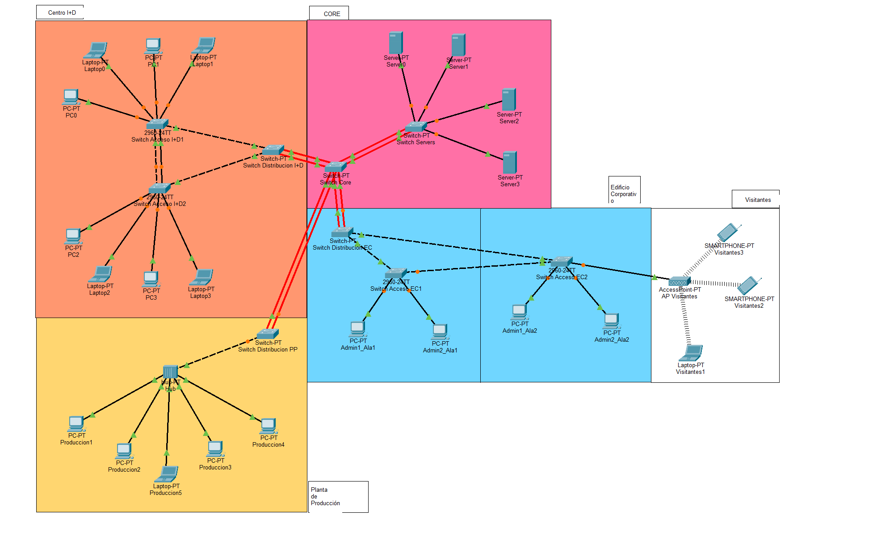
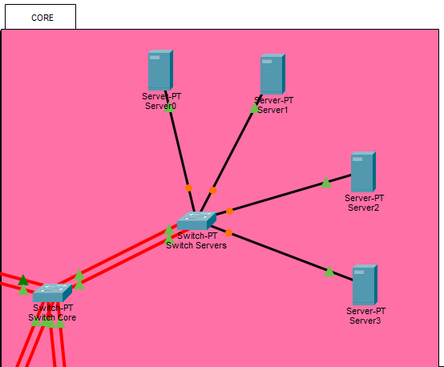
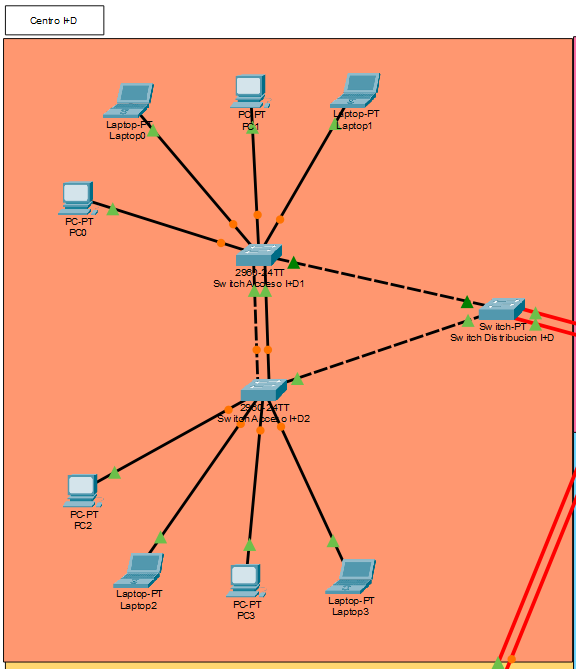
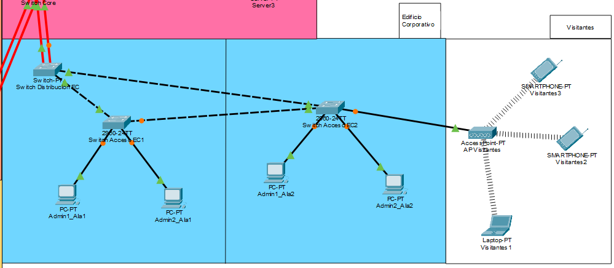
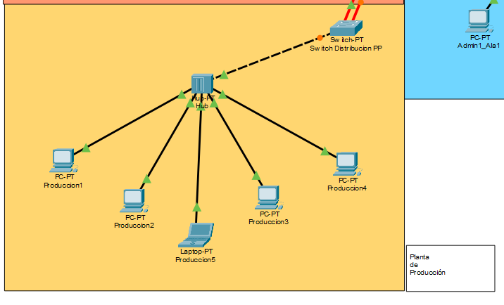
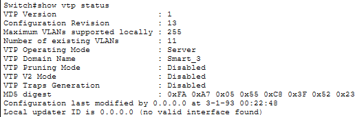
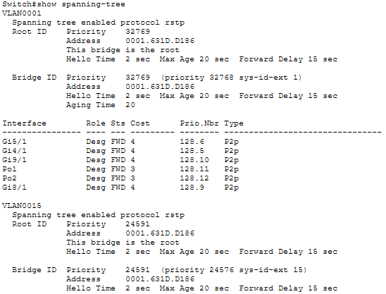
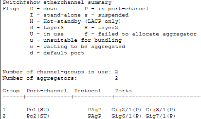
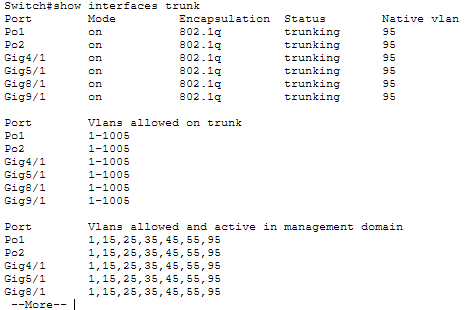

# Manual Técnico - Proyecto 1: SmartCity Tech Park

**Universidad San Carlos de Guatemala**  
**Facultad de Ingeniería**  
**Escuela de Ciencias y Sistemas**  
**Curso:** Redes de Computadoras 1  
**Semestre:** Segundo Semestre 2026  
**Estudiante:** Manuel Alejandro López Canel 
**Carnet:** 202302035  

---

## 1. Topología General del Campus

El diseño implementa una topología jerárquica con un núcleo central (Centro de Datos) interconectado a tres áreas operativas mediante enlaces troncales.



### 1.1 Diagramas por Área






### 1.2 Justificación de Medios de Transmisión

*   **Fibra Óptica (Backbone y Enlaces Críticos):** Se utilizó cableado de fibra óptica para los enlaces troncales que conectan el Switch Core con el Switch de Distribución de I+D y el Switch de Servidores. Esto se justifica por la necesidad de soportar una mayor demanda de ancho de banda y garantizar inmunidad ante interferencias electromagnéticas en trayectos largos.
*   **Cobre (UTP):** Utilizado en las conexiones de la capa de acceso hacia los dispositivos finales (PCs, Laptops, Hub) y en los enlaces cortos intra-edificio (entre switches de distribución y acceso). El cobre cumple eficientemente con las capacidades requeridas a distancias menores a 100 metros.

---

## 2. Segmentación Lógica y Dominios

### 2.1 Tabla de VLANs
Las VLANs fueron asignadas utilizando el último dígito del carnet (5) como identificador base.

| Edificio / Ubicación Física | VLAN ID | Nombre de la VLAN |
| :--- | :--- | :--- |
| Edificio Corporativo | 15 | Gerencia |
| Centro de I+D | 25 | Investigacion |
| Planta de Producción | 35 | Produccion |
| Centro de Datos | 45 | Servidores |
| Edificio Corporativo | 55 | Visitantes |
| Backbone | 95 | Nativa |

### 2.2 Tabla de Dominios de Broadcast

| Dominio de Broadcast | VLAN Asociada | Ubicación Principal |
| :--- | :--- | :--- |
| Dominio 1 | VLAN 15 | Edificio Corporativo (Ala 1 y Ala 2) |
| Dominio 2 | VLAN 25 | Centro de I+D |
| Dominio 3 | VLAN 35 | Planta de Producción |
| Dominio 4 | VLAN 45 | Centro de Datos (Servidores) |
| Dominio 5 | VLAN 55 | Edificio Corporativo (Red Inalámbrica) |
| Dominio 6 | VLAN 95 | Enlaces Troncales (Nativa) |

### 2.3 Tabla de Dominios de Colisión

| Equipo | Dominios de Colisión Generados | Observaciones |
| :--- | :--- | :--- |
| Switch Core | 8 | Conexiones Gigabit hacia switches de distribución. |
| Switch Servidores | 6 | 4 FastEthernet a servidores, 2 Gigabit a Core. |
| Switch Dist. I+D | 4 | 2 Gigabit a Core, 2 FastEthernet a Switches Acceso. |
| Switch Acc. I+D1 | 7 | 2 Gigabit y 1 FasthEthernet troncales,4 FastEthernet a PCs. |
| Switch Acc. I+D2 | 7 | 2 Gigabit y 1 FasthEthernet troncales, 4 FastEthernet a PCs. |
| Switch Dist. PP | 3 | 2 Gigabit a Core, 1 FastEthernet a Hub. |
| Switch Dist. EC | 4 | 2 Gigabit a Core, 2 FastEthernet a Switches Acceso. |
| Switch Acc. EC1 | 4 | 2 Gigabit troncales, 2 FastEthernet a PCs. |
| Switch Acc. EC2 | 5 | 2 Gigabit troncales, 2 FastEthernet a PCs, 1 a AP. |
| **Segmento Legacy** | **1** | El Hub agrupa a todas las PCs industriales y el puerto del Switch de Distribucion PP en un único dominio de colisión en Capa 1, operando en Half-Duplex. |

**Impacto del Segmento Legacy:** El dominio de colisión compartido provoca que solo un dispositivo pueda transmitir a la vez, reduciendo el ancho de banda efectivo e incrementando la latencia por retransmisiones (CSMA/CD). La mitigación consiste en limitar este segmento a un solo puerto del Switch de Acceso, evitando que las colisiones se propaguen al resto del campus.

---

## 3. Protocolos de Capa 2 y Justificaciones Técnicas

### 3.1 Administración Centralizada (VTP)
*   **Dominio:** `Smart_3`
*   **Contraseña:** `proyecto12S2026`
*   **Justificación:** El **Switch Core** fue configurado en modo `Server`. Al ser el punto central, es el equipo idóneo para crear, modificar y propagar las VLANs hacia los switches de distribución y acceso, los cuales operan en modo `Client`.



### 3.2 Spanning Tree Protocol (STP)
*   **Protocolo:** Rapid-PVST
*   **Justificación de Root Bridge:** El **Switch Core** fue forzado como Root Bridge primario (`root primary`) para todas las VLANs. Garantiza que el árbol de expansión calcule las rutas más cortas hacia el centro de datos.



### 3.3 Agregación de Enlaces (EtherChannel)
*   **Protocolo:** PAgP
*   **Justificación:** Se implementaron EtherChannels en los enlaces críticos (Core a Servidores y Core a I+D) agrupando múltiples interfaces Gigabit de fibra óptica para proveer tolerancia a fallos y multiplicar el ancho de banda disponible.



### 3.4 Enlaces Troncales
Todos los enlaces troncales fueron asegurados moviendo el tráfico sin etiquetar de la VLAN 1 a la VLAN Nativa 95.



---

## 4. Tabla de Asignación de Puertos

| Switch | Puertos / Interfaces | Modo / VLAN | Destino |
| :--- | :--- | :--- | :--- |
| Switch Core | Gig 2/1, 3/1, 4/1, 5/1, 6/1, 7/1, 8/1, 9/1 | Trunk (Nativa 95) | Sw. Servidores, Sw. Dist. I+D, EC, PP |
| Switch Core | Port-Channel 1 y 2 | Trunk (Nativa 95) | Agrupación EtherChannel |
| Sw. Servidores | Gig 6/1, 7/1 | Trunk (Nativa 95) | Switch Core |
| Sw. Servidores | Fa 0/1 a Fa 0/4 | Access (VLAN 45) | Granja de Servidores |
| Sw. Dist. I+D | Gig 6/1, 7/1, Fa 0/1, Fa 1/1 | Trunk (Nativa 95) | Sw. Core, Sw. Acc I+D1, Sw. Acc I+D2 |
| Sw. Acc. I+D | Gig 0/1, 0/2, Fa 0/24 | Trunk (Nativa 95) | Sw. Dist I+D, Enlace redundante |
| Sw. Acc. I+D | Fa 0/1 a Fa 0/4 | Access (VLAN 25) | Estaciones I+D |
| Sw. Dist. EC | Gig 6/1, 7/1, Fa 0/1, Fa 1/1 | Trunk (Nativa 95) | Sw. Core, Sw. Acc EC1, Sw. Acc EC2 |
| Sw. Acc. EC | Gig 0/1, 0/2 | Trunk (Nativa 95) | Sw. Dist EC, Enlace redundante |
| Sw. Acc. EC | Fa 0/1 a Fa 0/2 | Access (VLAN 15) | Laptops Gerencia |
| Sw. Acc. EC | Fa 0/3 (hacia AP) | Access (VLAN 55) | Visitantes (WLAN) |
| Sw. Dist. PP | Gig 6/1, 7/1, Fa 0/1 | Trunk (Nativa 95) | Sw. Core, Sw. Acc PP |
| Sw. Acc. PP | Gig 0/1 | Trunk (Nativa 95) | Sw. Dist PP |
| Sw. Acc. PP | Fa 0/1 | Access (VLAN 35) | Hub (Segmento Legacy) |

---

## 5. Lista de Comandos Utilizados

### Configuración Global (VTP, STP y VLANs en Core)
```text
enable
configure terminal
vtp mode server (o client en el resto de switches)
vtp domain Smart_3
vtp password proyecto12S2026
spanning-tree mode rapid-pvst
vlan 15
 name Gerencia
vlan 25
 name Investigacion
vlan 35
 name Produccion
vlan 45
 name Servidores
vlan 55
 name Visitantes
vlan 95
 name Nativa
```

### Configuración de Root Bridge (Core)
```text
spanning-tree vlan 15,25,35,45,55,95 root primary
```

### Configuración EtherChannel PAgP
```text
interface range gigabitEthernet 2/1, gigabitEthernet 3/1
channel-protocol pagp
channel-group 1 mode desirable (o auto en el extremo opuesto)
```

### Configuración de Puertos Troncales
```text
interface range [puertos_inter_switches]
switchport mode trunk
switchport trunk native vlan 95
```

### Configuración de Puertos de Acceso
```text
interface range [puertos_hacia_dispositivos]
switchport mode access
switchport access vlan [ID]
```

### Configuración MOTD (Switches de Distribución)
```text
banner motd #Acceso Restringido - TechPark_202302035#
```

---

## 6. Medios de Transmisión y Justificación Técnica

Para la interconexión física del **SmartCity Tech Park**, se realizó un diseño híbrido de cableado estructurado, adaptando los medios a las condiciones de cada edificio y a las necesidades específicas de la topología:

### 6.1 Backbone Principal (Fibra Óptica)
El **Centro de Datos** actúa como el núcleo de la red. Desde su Switch Core se despliegan enlaces hacia los switches de distribución de los 3 edificios restantes (I+D, Edificio Corporativo y Planta de Producción).
*   **Selección:** Fibra Óptica Multimodo (con transceptores SFP).
*   **Justificación para nuestro proyecto:** La conexión troncal hacia el **Centro de I+D** exige un alto ancho de banda, por lo que implementamos un EtherChannel. Usar fibra óptica en este trayecto y hacia el resto de los edificios previene la atenuación de la señal por la distancia (típicamente mayor a 100m entre edificios en un campus) y anula por completo la interferencia electromagnética (EMI), lo cual es crítico dado que uno de los trayectos pasa cerca de la maquinaria pesada de la Planta de Producción.

### 6.2 Capa de Acceso y Segmento Legacy (Cobre UTP/STP)
Las conexiones locales dentro de cada área (desde los switches de acceso hacia dispositivos finales) operan en un entorno controlado.
*   **Selección General:** Cable de par trenzado no apantallado (UTP) Categoría 6.
*   **Justificación para nuestro proyecto:** Las distancias internas hacia las PCs de Gerencia, las estaciones de I+D, la granja de servidores (dentro del mismo rack) y el Access Point de Visitantes son cortas. El UTP Cat6 garantiza velocidades Gigabit a un costo manejable.
*   **Excepción en Planta de Producción:** Para el segmento *Legacy* (donde el switch de acceso se conecta al Hub Ethernet industrial y a las máquinas antiguas), es imperativo utilizar par trenzado apantallado (**STP**). La maquinaria industrial genera altos niveles de ruido electromagnético que corromperían las tramas en un cable UTP convencional, exacerbando las colisiones inherentes al Hub.

---

## 7. Presupuesto Estimado de Equipos

La siguiente cotización está elaborada en Quetzales (Q), considerando una tasa de cambio de referencia de Q7.75 por dólar estadounidense.

| Categoría | Equipo / Componente | Cantidad | Costo Unit. (GTQ) | Total (GTQ) |
| :--- | :--- | :--- | :--- | :--- |
| Switch de Núcleo | Cisco Catalyst Serie 9300 (Modular) | 1 | Q21,700.00 | Q21,700.00 |
| Switches Distribución | Cisco Catalyst Serie 3650 (Modular) | 4 | Q11,625.00 | Q46,500.00 |
| Switches de Acceso | Cisco Catalyst 2960-X (24 Puertos) | 4 | Q6,200.00 | Q24,800.00 |
| Transceptores | Módulo SFP 1000BASE-SX | 8 | Q465.00 | Q3,720.00 |
| Enlaces Troncales | Patch Cords Fibra Óptica LC-LC (2m) | 4 | Q193.75 | Q775.00 |
| Enlaces Internos | Bobina Cable UTP Cat6 (305m) | 2 | Q930.00 | Q1,860.00 |
| Segmento Industrial | Hub Ethernet Legacy | 1 | Q387.50 | Q387.50 |
| Red Visitantes | Cisco Aironet Access Point | 1 | Q3,487.50 | Q3,487.50 |
| **Total Inversión:** | | | | **Q103,230.00** |

### 7.1 Referencias y Criterios de Cotización

Para validar el presupuesto anterior, los valores de referencia se tomaron de catálogos y proveedores corporativos, adaptando los costos al contexto nacional:

1. **Infraestructura de Conmutación (Switches y APs):** Los precios de equipos Cisco Catalyst y Aironet fueron estimados basándose en precios de mercado de integradores y plataformas B2B. 
   *   *Enlaces:* [Router-Switch.com (Precios Base Cisco)](https://www.router-switch.com/) | [GBM (Integrador Regional)](https://www.gbm.net/)
2. **Medios de Transmisión (Fibra Óptica y Transceptores SFP):** Los costos fueron obtenidos de proveedores globales especializados en conectividad de data centers y enlaces ópticos compatibles con Cisco.
   *   *Enlaces:* [FS.com (Óptica y Transceptores)](https://www.fs.com/es/)
3. **Cableado Estructurado (Cobre UTP/STP):** Estimaciones basadas en precios de distribuidores mayoristas de marcas certificadas como Panduit o Belden en la región centroamericana.
   *   *Enlaces:* [Intcomex Guatemala](https://store.intcomex.com/es-XGT/Home) | [Panduit LATAM](https://www.panduit.com/es/home.html)